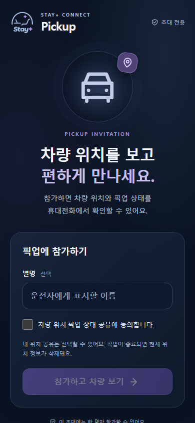

# Pickup mobile Premium UI — 2026-11-13

## Scope and source of truth

Actual checkout: `C:\Users\ukhan\pleos-stay-plus`, `dev`, starting HEAD `a8ce4df`. Latest fetched upstream dev was `dfcb375`; local changes were ahead, not missing remote commits. No main change/reset/force push.

Read root AGENTS.md, DEVELOPMENT_GUIDE.md section21, OpenAPI Pickup contract, web AGENTS/installed Next16 docs, and the Notion Pickup specification: https://app.notion.com/p/40cb74b2b9058104a652dab710f91487 . The older Notion Waiting-led flow is superseded by the user's independent Pickup decision and current section21; no Waiting dependency was introduced.

User requested a fully usable participant mobile page matching existing Stay+ branding. Existing Kakao JS provider and Supabase anonymous identity were reused. No backend/DB/API/Android/home/Realtime policy or new dependency was added.

## Implemented experience

- Driver share page: existing logo, navy/purple visual language, link copy and native sharing. It does not disclose coordinates or automatically enroll its viewer.
- Guest page: explicit consent, optional nickname, large touch targets, responsive320/390/430px layouts, safe-area and keyboard handling. Invalid invitation/session links use a consistent closed screen.
- Connected view: actual authorized vehicle coordinates, last-observation freshness, separate participant marker only while opted in and its observation is fresh, explicit simulated/stale labels, map follow/fit controls, existing Kakao directions link. No fabricated car/plate/address/ETA or parking availability.
- State actions: departure/nearby reflect the server; backwards/repeated status buttons disabled. Manual completion/cancellation requires confirmation and reuses a request key for retry.
- GPS: optional browser permission, approximately5-second upload target, watch and in-flight request cancellation, late callback protection, explicit denial/error handling, permission-change monitoring, no automatic restart after denial/stop. Closing or leaving the page stops collection. No background update guarantee.
- Auth/session: existing Supabase sessions refresh near expiry; stored binding is scoped to the invitation fingerprint and guest. Different invitations cannot silently recover an old Pickup. Reload, offline/online, visibility and browser history restoration re-query the authorized snapshot. Late/older replies cannot resurrect a cleared session.
- Realtime: subscribe to existing authorized Pickup events/current-location/session tables, then fetch authoritative snapshots. Visible-page polling5seconds remains a fallback. Completion/revocation removes the map, binding and GPS state.
- SDK adapter: map initialized once, markers updated in place. Document stays No-Referrer; the SDK script sends origin only for Kakao domain authorization, never the invitation path.

## Actual defect found and fixed

Real browser signup succeeded200, but optional blank nickname caused redeem400 INVALID_REQUEST: the previous client always sent `displayName:""`, while the existing server rejects empty strings. The client now omits the optional field when blank and trims supplied names. The backend contract/policy was not changed. A dedicated client regression covers both cases.

## Architecture / modified files

| Layer | Files |
|---|---|
| Rendering | web/components/PickupPanel.tsx, PickupMobileChrome.tsx, SharePanel.tsx |
| Session/UI actions | web/components/usePickupSession.ts |
| HTTP contract | web/lib/api.ts — optional blank name and optional retry key/signal |
| Browser location | web/lib/pickup-gps.ts |
| Display/binding rules | web/lib/pickup-mobile.ts |
| Map SDK | web/components/KakaoPickupMap.tsx |
| Routes/viewport/styles | web/app/layout.tsx, pickup/[token]/page.tsx, share/[token]/page.tsx, pickup-mobile.css |
| Asset | web/public/stay-brand-logo.png |
| Regression | web/test/pickup-client.test.ts, pickup-mobile.test.ts |
| Documentation | web/README.md, this report and preview asset |

`stay-brand-logo.png` is a byte-for-byte copy of existing approved `android/app/src/main/res/drawable-nodpi/stay_brand_logo.png`,1228×1281. The Android file and approved home are unchanged. No new generated/downloaded product imagery or license was introduced.

## Verification

| Test | Result | Boundaries |
|---|---|---|
| Web unit/client tests | PASS |16; GPS stop/late callback/denial, stale observedAt, invite mismatch, status guards, safe errors, optional nickname, stable close key |
| Web typecheck / production build | PASS | Installed locked Next16.4.4; no new dependencies |
| Backend regression / typecheck | PASS |31 tests, unchanged backend contract |
| Browser mobile interaction tests | PASS |13 checks in real Headless Chrome; **local-only mocked Auth/map/GPS/API**, never a production demo |
| Real browser + actual Auth/Fastify/Supabase | PASS |7 checks: consent, blank-name auth/redeem/snapshot, departure, nearby, reload recovery, confirmation before close, actual manual completion. No mock identity or GPS permission requested |
| Actual Kakao JS SDK | PASS locally | Registered localhost:3001, real SDK/map resources and CustomOverlay vehicle marker;3 checks. Coordinates were explicitly synthetic/local QA, not actual vehicle GPS |
| Referrer privacy + actual SDK | PASS locally | Same No-Referrer page header as product; SDK script referrerPolicy=origin; map resources and marker rendered |
| Mobile widths320/390/430 | PASS | document scroll width equals viewport, no out-of-bounds content. Actual join screen screenshot below |
| Actual phone QR/GPS/background behavior | NOT RUN | No physical phone permission/camera interaction; no real GPS collected |
| Real Pleos vehicle position movement | NOT RUN | Existing Android gateway not changed. Empty authorized snapshot shows waiting, never invented coordinates |
| Android rebuild/emulator restart | NOT RUN in this change | Web-only changes; existing emulator and app retained |

The mocked browser checks cover consent gating, marker updates without map recreation, optional GPS/second marker, stop/late callback, denial with map retained, status transitions, stale position notice, no horizontal overflow, revoked access clearing the map, and manual completion confirmation. Test code/fixtures ran only in ignored loopback QA launchers. No fake identity/location behavior is shipped with the web app.

The real browser flow was rerun after the session-lifecycle/Realtime additions using the existing actual guest auth session; all7 checks passed. Earlier failed browser attempts were traced to the blank-name bug rather than misreported as a network issue. The final GPS-stop copy adjustment does not alter that authenticated flow.

## Kakao domain blocker: public mobile map

- Existing JS key: SDK request from registered `http://localhost:3001` returned200 and the actual browser rendered the map.
- Current temporary HTTPS origin: SDK returned401 AccessDeniedError with a domain rejection. No Kakao console setting, API key, quota or billing was changed.
- Registering a Quick Tunnel hostname does not make it permanent; a new tunnel hostname requires a new registration. User questioned whether to register it, so no registration was inferred. The public map remains **BLOCKED pending an allowed public origin**. Other participant UI/API flows are implemented.
- Map error state is explicit and retains status controls. Existing external directions action is offered only when the server has a valid vehicle coordinate.

## Preview and privacy

Preview is the actual React page before participant consent, with no user location or credentials. Local-only SDK smoke screenshots are kept under ignored backend/.cache/qa-runtime, visibly marked test location; they are not evidence of a real car location.

Browser tooling initialization failed, so the installed Chrome official Headless CLI was used with separate QA profiles, not the user's normal browser. Test frames and fixture proxies bind loopback only; public allow-list never exposes them. Temporary SDK fixture routes were removed after validation. No invitation token, user ID, PIN, secret key or private document was printed/committed.

Mobile live testing created seven anonymous QA accounts in total across initial failure diagnosis and reruns (the last run reused an existing guest). Own QA Pickup sessions were closed through normal APIs; anonymous account/idempotency metadata remains. No admin deletion, DB cleanup, schema/RLS change or real user session modification.

## Remaining scope

- Public mobile embedded map needs a registered HTTPS origin. Local SDK verification is not a claim of public domain approval.
- Physical mobile location permissions/background throttling, real vehicle updates, and end-to-end phone QR scan remain device QA.
- Android Pickup restart-after-terminal / first-location safety race / lost reissue-response findings from `2026-11-13-realtime-pickup-live-qa.md` remain outside this mobile UI change and are not claimed fixed.
- No push/deployment was performed. Production build is served locally behind the already-approved temporary QA proxy. No fixed hosting/domain was selected.

Sources checked: https://apis.map.kakao.com/web/documentation/ ; https://developer.mozilla.org/en-US/docs/Web/API/Geolocation/watchPosition ; https://developer.mozilla.org/en-US/docs/Web/API/HTMLDialogElement/showModal ; https://developer.chrome.com/docs/automation-and-testing/headless . Next viewport/page/logging behavior was checked against installed node_modules/next/dist/docs.
An additional QA cleanup POST after completed tests was rejected by automatic approval review for possible remote data deletion and was not executed. No workaround or further database cleanup was attempted; only local test helper processes were stopped. This did not block the implementation or completed test results.
